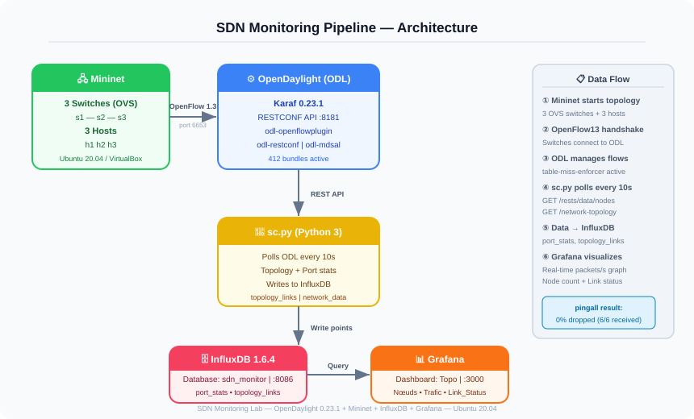
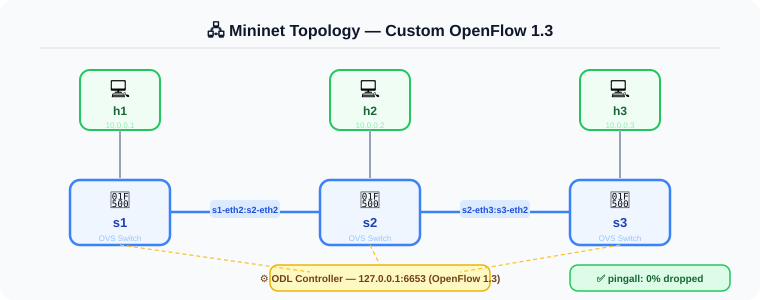

# 📡 SDN Monitoring Lab — OpenDaylight + Mininet + Grafana

> A Software Defined Networking (SDN) lab with real-time traffic monitoring using OpenDaylight as the controller, Mininet for network emulation, InfluxDB for time-series storage, and Grafana for visualization.

---

## 📋 Project Overview

This lab demonstrates a full SDN monitoring pipeline. A custom Python script (`sc.py`) collects network statistics from OpenDaylight's REST API and pushes them to InfluxDB, which is then visualized in real time via a Grafana dashboard.

---

## 🏗️ Architecture



---

## 🧩 Components

### Controller — OpenDaylight (Karaf 0.23.1)

- SDN controller managing all OpenFlow switches
- RESTCONF API on port `8181`
- Features installed:
  - `odl-openflowplugin-flow-services`
  - `odl-openflowplugin-app-table-miss-enforcer`
  - `odl-restconf`
  - `odl-mdsal-models`

### Network Emulation — Mininet

- Custom topology: 3 switches (s1, s2, s3) + 3 hosts (h1, h2, h3)
- Protocol: OpenFlow 1.3
- Connected to ODL controller at `127.0.0.1:6653`
- `pingall` result: **0% packet loss**

### Data Collector — sc.py (Python 3)

- Polls ODL REST API every 10 seconds
- Collects topology links and port statistics
- Pushes data to InfluxDB (`sdn_monitor` database)
- Measurements: `topology_links`, `network_data`, `port_stats`

### Time-Series DB — InfluxDB 1.6.4

- Database: `sdn_monitor`
- Measurements stored: `port_stats`, `topology_links`, `network_data`

### Visualization — Grafana

- Dashboard: **Topo**
- Panels:
  - **Nœuds** — Total active nodes (stat panel)
  - **Trafic** — Real-time traffic graph (packets/s)
  - **Link_Status** — Topology link status over time

---

## 🖥️ Mininet Topology




| Node | Type       | Connected to |
| ---- | ---------- | ------------ |
| h1   | Host       | s1-eth1      |
| h2   | Host       | s2-eth1      |
| h3   | Host       | s3-eth1      |
| s1   | OVS Switch | s2           |
| s2   | OVS Switch | s1, s3       |
| s3   | OVS Switch | s2           |

---

## 📁 Repository Structure

```
sdn-monitoring-lab/
├── README.md
├── topo.py              # Custom Mininet topology
├── sc.py                # ODL stats collector → InfluxDB
├── screenshots/         # Lab screenshots
└── docs/
    ├── Installation.txt # ODL install steps
    ├── Mininet.txt      # Mininet setup commands
    ├── InfluxDB.txt     # InfluxDB setup commands
    ├── Grafana.txt      # Grafana queries
    ├── Features.txt     # ODL features to install
    └── Start_Topo.txt   # How to start the topology
```

---

## 🚀 Getting Started

### 1. Install OpenDaylight

```bash
sudo su
apt-get update
apt-get install openjdk-21-jre openjdk-21-jdk unzip
wget https://nexus.opendaylight.org/content/repositories/opendaylight.release/org/opendaylight/integration/karaf/0.23.1/karaf-0.23.1.zip
unzip karaf-0.23.1.zip
cd karaf-0.23.1/bin/
export JAVA_HOME=/usr/lib/jvm/java-1.21.0-openjdk-amd64
./karaf
```

### 2. Install ODL Features (inside Karaf shell)

```
feature:install odl-openflowplugin-flow-services
feature:install odl-openflowplugin-app-table-miss-enforcer
feature:install odl-restconf
feature:install odl-mdsal-models
```

### 3. Setup Mininet

```bash
sudo apt install mininet
sudo service openvswitch-switch start
```

### 4. Start the Topology

```bash
sudo mn --custom topo.py --topo matopo \
  --controller=remote,ip=127.0.0.1,port=6653 \
  --switch=ovsk,protocols=OpenFlow13
mininet> pingall
```

### 5. Setup InfluxDB

```bash
sudo systemctl start influxdb
influx
> CREATE DATABASE sdn_monitor
> USE sdn_monitor
```

### 6. Run the Collector

```bash
python3 sc.py
```

### 7. Open Grafana

- URL: `http://localhost:3000`
- Add InfluxDB as data source → database: `sdn_monitor`
- Import the **Topo** dashboard

---

## 📊 Grafana Queries

**Nodes count:**

```sql
SELECT last("total_nodes") FROM "network_data"
```

**Traffic (packets/s):**

```sql
SELECT non_negative_derivative(mean("received_packets"), 10s)
FROM "network_data"
WHERE $timeFilter
GROUP BY time($__interval) fill(0)
```

**Port stats:**

```sql
SELECT non_negative_derivative(last("received_packets"), 1s)
FROM "port_stats"
WHERE $timeFilter
GROUP BY time($__interval) fill(0)
```

---

## 🛠️ Tools & Technologies


---

## 📌 Key Concepts Covered

- Software Defined Networking (SDN) fundamentals
- OpenFlow 1.3 protocol
- OpenDaylight controller setup and feature management
- Custom network topology with Mininet
- REST API polling from a Python script
- Time-series data storage with InfluxDB
- Real-time network monitoring with Grafana dashboards

---

## 👤 Author

**Yasser** — Network & Security Engineer  
🔗 [GitHub](https://github.com/Yasser-02G)

---

> ⚠️ **Disclaimer:** This lab is for educational purposes only. All configurations run in an isolated virtual environment (VirtualBox + Ubuntu 20.04).
